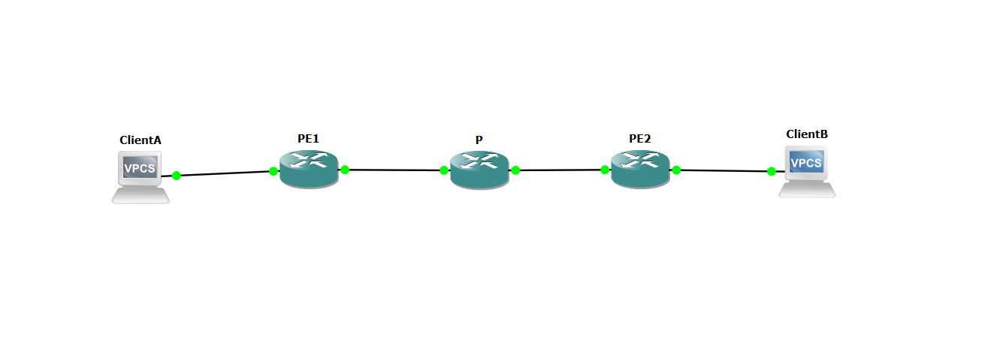
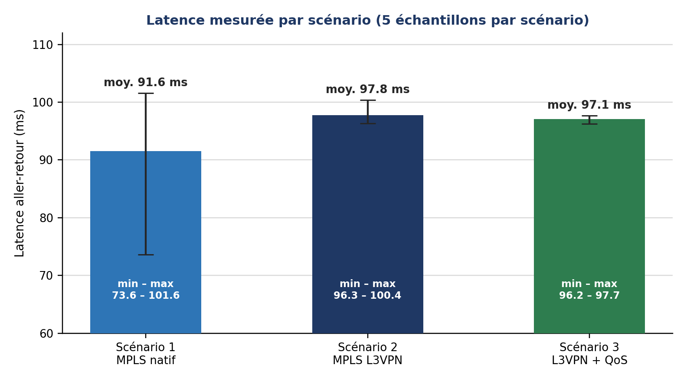
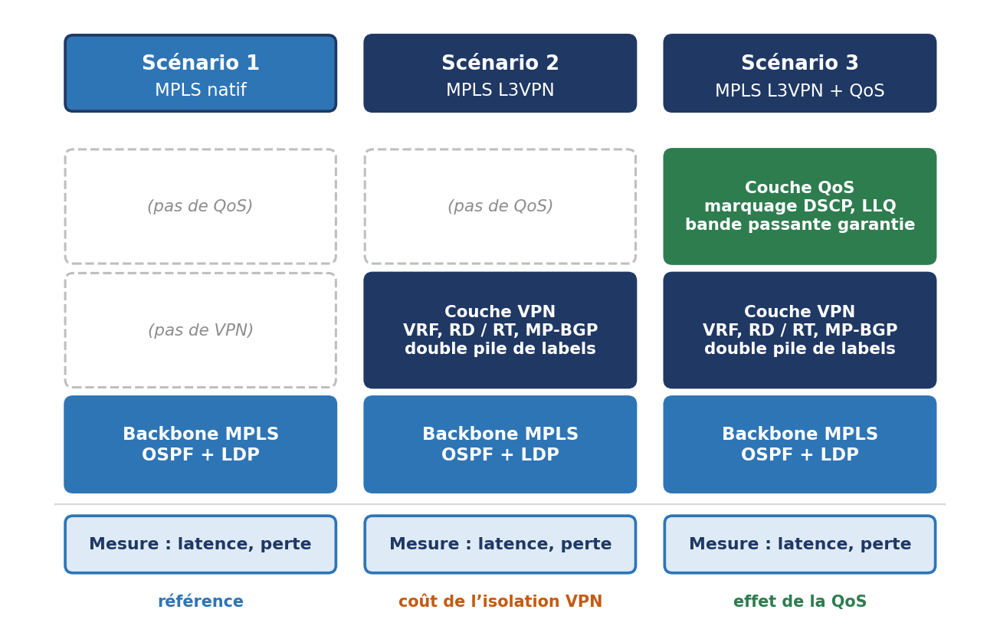
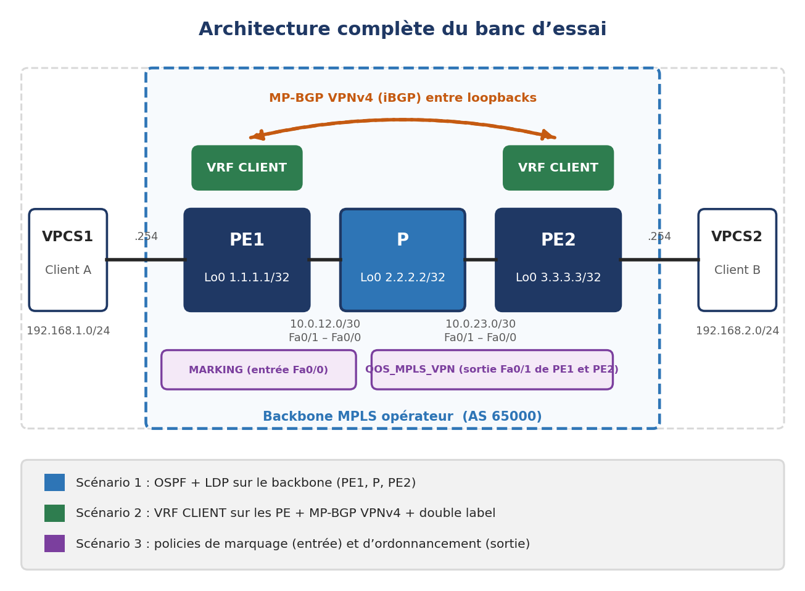
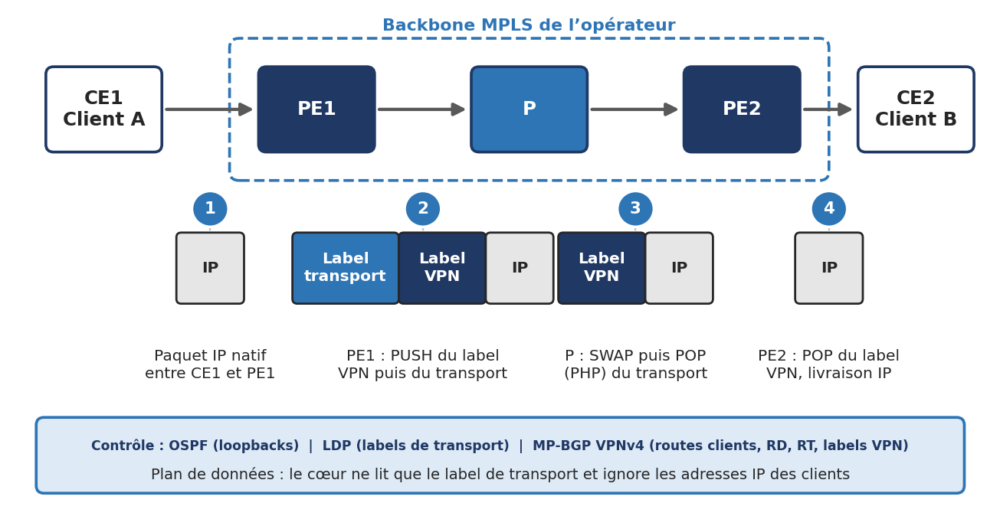
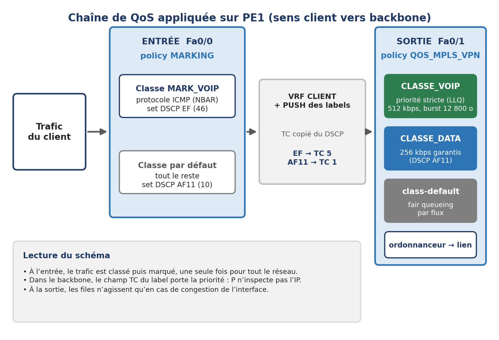
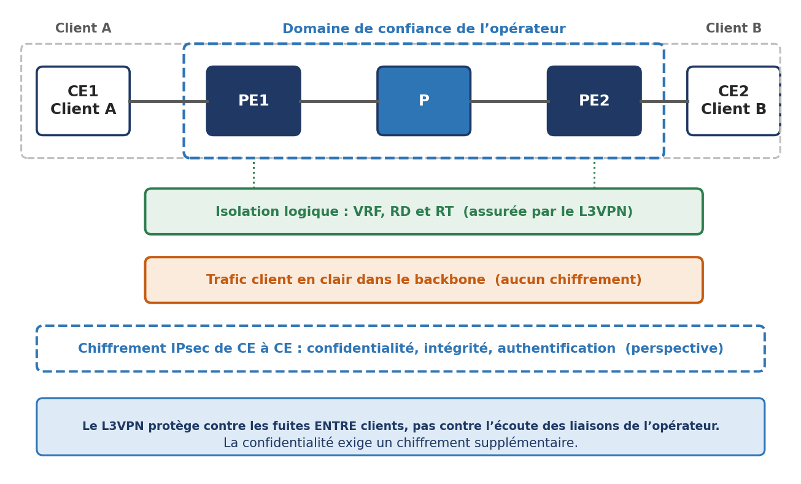
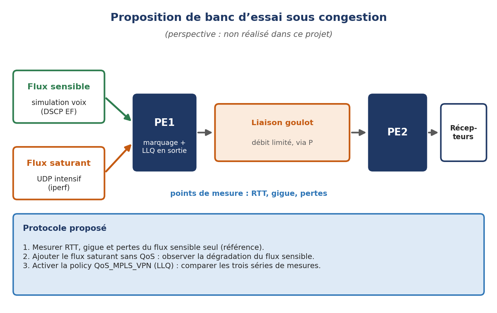

# MPLS L3VPN and QoS: Measuring the Cost of Isolation

An operator backbone built in **GNS3** in three cumulative steps, each one measured: native MPLS, then MPLS L3VPN (VRF and MP-BGP VPNv4), then L3VPN with DSCP EF marking and LLQ. Only one layer changes at each step, so any difference in the measurements can be attributed to the layer that was added.

**Question:** in an MPLS architecture, what is the measurable impact of adding a VPN layer on quality of service, and does a QoS policy preserve the performance of sensitive flows?



| | |
|---|---|
| **Author** | Ali Harti |
| **Programme** | Génie Informatique, engineering cycle, specialty Networks, Systems and Security |
| **Academic year** | 2025/2026 |
| **Environment** | GNS3, Cisco 3725 routers (MPLS, LDP, BGP, VRF), VPCS clients |
| **Report** | [`docs/`](docs/) (French) |

## Real-World Context: Why This Project Exists

### 1. The Real-World Need
In Tier-1 Internet Service Provider (ISP) and telecommunications carrier networks, multiple enterprise customers (or distinct institutions) must share a single physical backbone infrastructure:
- **Customer Isolation & Overlapping Address Spaces:** Independent corporate clients frequently use the exact same RFC 1918 private IP subnets (e.g., both Client A and Client B use `192.168.1.0/24`). Traditional IP routing cannot distinguish or isolate these routes without catastrophic routing collisions or data cross-contamination. 
- **The SLA Cost of Virtualization:** Carrier-grade Service Level Agreements (SLAs) strictly dictate latency, jitter, and packet delivery guarantees. While **MPLS L3VPN** (using Virtual Routing and Forwarding — VRF) solves multi-tenant isolation, it introduces processing overhead: double-label encapsulation (transport label + VPN label) and route table lookups per VRF. Network architects need empirical data on the exact performance penalty of virtualization.
- **Service Differentiation Across the Core:** Carrier backbones carry mixed traffic profiles—ranging from bulk file transfers and database backups to delay-sensitive voice (VoIP) and interactive applications. Without strict Quality of Service (QoS), bursty bulk traffic can degrade mission-critical flows.

### 2. Why We Built This Lab
The objective was to empirically answer a fundamental networking question: *What is the exact latency cost of adding client isolation via MPLS L3VPN, and can DiffServ QoS with Low Latency Queuing (LLQ) protect sensitive business traffic without incurring additional delay?*
By engineering an emulated carrier core in GNS3 with Cisco 3725 routers, we executed a controlled, 3-step progressive benchmark:
1. **Scenario 1 (Baseline):** Native MPLS with LDP and OSPF to establish baseline transport latency.
2. **Scenario 2 (Isolation):** Adding MPLS L3VPN (VRFs, Route Distinguishers, Route Targets, and MP-BGP VPNv4) to measure the exact latency cost of tenant isolation.
3. **Scenario 3 (Protection):** Implementing DiffServ classification, DSCP EF marking, and Low Latency Queuing (LLQ) to evaluate traffic shaping through the VPN.

### 3. What Was Engineered
- **Carrier Core Architecture:** Linear provider topology with Provider Edge (PE1, PE2) and Core Provider (P) routers running Cisco IOS.
- **MPLS Transport Backbone:** Interior Gateway Protocol (OSPF Area 0) and Label Distribution Protocol (LDP) establishing label switched paths (LSPs).
- **Multi-Tenant L3VPN Virtualization:** VRF instantiation with unique Route Distinguishers (RD) and Route Targets (RT) for BGP import/export policy enforcement.
- **MP-BGP Peering:** BGP session carrying VPNv4 routes with 2-level MPLS label switching across the core.
- **Modular QoS CLI (MQC):** Differentiated Services (DiffServ) architecture marking mission-critical traffic with DSCP EF and allocating dedicated 512 kbps priority queue bandwidth with LLQ.
- **Reproducible Performance Analysis:** Measured latency datasets across scenarios with automated analysis scripts (`results/summarize.py`).

## Results at a glance

| | Scenario 1: native MPLS | Scenario 2: L3VPN | Scenario 3: L3VPN + QoS |
|---|---|---|---|
| Mean latency | **91.6 ms** | **97.8 ms** (+6.8%) | **97.1 ms** |
| Observed range | 73.6 to 101.6 ms | 96.3 to 100.4 ms | 96.2 to 97.7 ms |
| Packet loss | 0% | 0% | 0% |
| Labels in the stack | 1 (transport) | 2 (transport + VPN) | 2 |
| Client isolation | No | Yes (VRF) | Yes (VRF) |
| Sensitive traffic prioritised | No | No | Yes (DSCP EF, LLQ 512 kbps) |



**How to read this:**
- Adding the L3VPN cost about **6.2 ms (+6.8%)** of mean latency with no packet loss, which is the expected direction for a double encapsulation plus a VRF lookup.
- Scenario 3 stays within 0.7 ms of Scenario 2, which is below the spread of the measurements. **Without congestion, QoS neither shortens nor lengthens the path.** This study does not claim a QoS gain: it validates that classification, marking and queuing work end to end.
- Routers are emulated and share the host CPU, so absolute values (about 90 to 100 ms) mean nothing for production. Only the comparison between scenarios, under the same conditions, is usable.
- Each scenario has **five samples** and no significance test was run. The 6 ms gap is indicative. Raw values are in [`results/latency-samples.csv`](results/latency-samples.csv), and `python3 results/summarize.py` recomputes the table above.

## The three scenarios



| # | Architecture | Added | Question |
|---|---|---|---|
| 1 | Native MPLS | OSPF and LDP | What is the baseline performance? |
| 2 | MPLS L3VPN | VRF, RD, RT, MP-BGP, two-label stack | What does VPN isolation cost? |
| 3 | MPLS L3VPN + QoS | DSCP marking, LLQ, guaranteed bandwidth | Does QoS protect sensitive flows? |

### Test bed



Linear topology Client A, PE1, P, PE2, Client B. It is the smallest layout that shows both an edge router and a core router, so the transport label switched by P is visible. The VPCS clients connect directly to the PEs and act as both host and CE.

| Device | Interface | Address |
|---|---|---|
| PE1 | Fa0/0 (client side) | 192.168.1.254/24 |
| PE1 | Fa0/1 (backbone) | 10.0.12.1/30 |
| PE1 | Loopback0 | 1.1.1.1/32 |
| P | Fa0/0 / Fa0/1 | 10.0.12.2/30 / 10.0.23.1/30 |
| P | Loopback0 | 2.2.2.2/32 |
| PE2 | Fa0/0 (backbone) | 10.0.23.2/30 |
| PE2 | Fa0/1 (client side) | 192.168.2.254/24 |
| PE2 | Loopback0 | 3.3.3.3/32 |

Method: ping from VPCS1 to VPCS2 (192.168.2.1) for round-trip time and loss, traceroute from PE1 to the PE2 loopback to expose the labels, and router state commands (neighbours, switching tables, QoS counters) to verify each mechanism **before** measuring.

## What was verified

| Scenario | Check | Observation | Evidence |
|---|---|---|---|
| 1 | OSPF on P | Two neighbours (1.1.1.1 and 3.3.3.3) in FULL | [fig 11](images/evidence/fig11-p-ospf-neighbors.png) |
| 1 | LDP on P | Sessions with both PEs in state Oper | [fig 12](images/evidence/fig12-p-ldp-neighbors.png) |
| 1 | MPLS table on P | Four prefixes with "Pop tag" (P is the penultimate hop, PHP) | [fig 13](images/evidence/fig13-p-mpls-forwarding-scenario1.png) |
| 1 | Traceroute PE1 to 3.3.3.3 | `[MPLS: Label 17 Exp 0]` at P, no label at PE2 (PHP) | [fig 14](images/evidence/fig14-traceroute-pe1-to-pe2-loopback.png) |
| 1 | End to end | 5/5 replies, TTL 61 | [fig 15](images/evidence/fig15-ping-scenario1.png) |
| 2 | VRF CLIENT on PE1 | RD 65000:1, RT import/export 65000:100, client network absent from the global table | [fig 16](images/evidence/fig16-pe1-vrf-client-detail.png) |
| 2 | MP-BGP | iBGP session to 3.3.3.3 in AS 65000, VPNv4 route 192.168.2.0 learned with next hop 3.3.3.3 | [fig 17](images/evidence/fig17-pe1-bgp-vpnv4-summary.png), [fig 18](images/evidence/fig18-pe1-bgp-vpnv4-table.png) |
| 2 | VRF routing table | 192.168.1.0/24 connected, 192.168.2.0/24 via BGP (AD 200) | [fig 19](images/evidence/fig19-pe1-vrf-routing-table.png) |
| 2 | Two-label stack | `[V]` marker on 192.168.1.0/24, VPN label 20, transport label 17 towards PE2 | [fig 20](images/evidence/fig20-pe1-mpls-forwarding-scenario2.png) |
| 3 | Marking | Policy `MARKING` on Fa0/0 of PE1, **20 of 20 ICMP packets marked DSCP EF** | [fig 25](images/evidence/fig25-pe1-fa0-0-service-policy.png), [fig 26](images/evidence/fig26-pe1-policy-map-statistics.png) |
| 3 | Long run | 1,000-packet ping between the clients | [fig 27](images/evidence/fig27-ping-scenario3-1000-packets.png) |



## QoS design



| Level | Policy-map | Applied on | Role |
|---|---|---|---|
| 1. Ingress | `MARKING` | Client interface Fa0/0, inbound | NBAR classifies ICMP as VoIP stand-in: `set dscp ef`; everything else `set dscp af11` |
| 2. Egress | `QOS_MPLS_VPN` | Backbone interface Fa0/1, outbound | `CLASSE_VOIP` (DSCP EF): strict priority 512 kbps. `CLASSE_DATA` (DSCP AF11): 256 kbps guaranteed. `class-default`: flow-based fair queueing |

The DSCP value is copied into the MPLS TC field when labels are pushed (EF 46 gives TC 5, AF11 10 gives TC 1), so the P router can apply the same treatment without reading the customer IP header. **ICMP stands in for voice** because it is easy to generate on VPCS. It validates the chain but does not reproduce real RTP voice traffic.

Parameters and policy outputs are collected in [`docs/configuration-summary.md`](docs/configuration-summary.md).

## What an L3VPN does and does not secure



| Property | Provided by MPLS L3VPN? |
|---|---|
| Routing and traffic isolation between customers (VRF, RT) | Yes |
| Independent, overlapping address spaces (RD) | Yes |
| Protection against label injection from a customer | Yes (the PE does not switch labelled packets from a CE) |
| Cryptographic confidentiality | **No**: traffic is in clear text inside the backbone |
| Integrity and authentication of customer data | **No** |

In this project "VPN security" means logical isolation, not encryption. None of the three scenarios encrypts traffic. A customer who needs confidentiality against the operator must add IPsec on top of or inside the VPN. (Project 1 of this portfolio covers GRE over IPsec: [network-core-gre-ipsec-dmz-nat](https://github.com/ali-harti/network-core-gre-ipsec-dmz-nat).)

## Limits

- Five latency samples per scenario, no significance test
- Emulated environment: high and variable absolute latencies, not transferable to physical hardware
- **No congestion test**, so the benefit of LLQ on latency and jitter is not measured
- ICMP as voice substitute, no real RTP flow
- A single VRF: isolation between several customers is not actively tested
- No encryption in scope

## Next steps

| Next step | What it would show |
|---|---|
| 1,000+ samples with mean, standard deviation and jitter | The VPN overhead with a margin of error |
| Competing traffic (iperf) until the backbone link saturates | The real LLQ gain on latency and loss |
| UDP flow imitating voice | Jitter and loss for realistic real-time traffic |
| A second VRF with different RTs | Proof of isolation (no reachability between customers) |
| IPsec over the MPLS VPN | Cost of confidentiality versus isolation alone |
| LDP/BGP authentication, `max-prefix` | A smaller attack surface for the backbone |



## Repository layout

```
.
├── README.md
├── LICENSE
├── .gitignore
├── docs/
│   ├── Rapport_MPLS_VPN_QoS_Reseaux_Securite.docx   # full report (French)
│   └── configuration-summary.md                      # addressing, VRF, BGP and QoS parameters
├── results/
│   ├── latency-samples.csv                           # raw RTT values from the report
│   └── summarize.py                                  # recomputes mean/min/max/stdev
└── images/
    ├── topology.png, architecture.png, qos-chain.png, ...   # diagrams
    └── evidence/                                     # router and VPCS screenshots, figures 8 to 27
```

## Notes

- This repository contains the **design parameters and verified outputs** published in the report. It does not contain full `running-config` exports of PE1, P and PE2.
- The GNS3 project file is not included.
- Report figure numbers are kept in the file names of `images/evidence/` so each screenshot can be traced back to the report.

## Author

Ali Harti.
